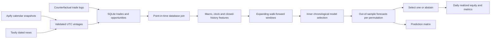

# Architecture and review notes

1. Authenticate with environment-variable secrets. Store raw responses plus run/dataset IDs; never store authentication headers.
2. Normalize values, verify units, retain immutable economic vintages and distinguish release, observation and entry time.
3. Join opportunities to event snapshots in SQLite using release/availability cutoffs. Prior trade features require closed outcomes; no target columns are predictors.
4. Keep all permutations together in each time window, purge unavailable labels and use a historical inner validation block.
5. Report aggregated outer-test decisions with benchmark policies, costs, abstentions and realized accounting limitations. Fit full history only for the separate future forecast.

## Important limits

The implementation focuses on leakage control and reproducibility rather than claiming causality, a sentiment ground truth or real profitability. Unknown future event actuals and historically revised consensus cannot be reconstructed from today's scrape. Calendar schedule-ahead features are deliberately omitted because a historical calendar collection time was not supplied. Current Tavily stories do not retroactively fill old features.

The economic signs are heuristics; stronger payrolls, lower CPI or lower policy surprises do not universally imply positive returns. Asset class, yields, positioning and recession fears can reverse market reactions. More defensible sentiment modeling requires a validated taxonomy and asset-specific training/labels.

Model selection can overfit even with walk-forward windows, especially after repeated analyst experimentation. Preserve a genuinely untouched final period after integrating real logs. The assessment demo is not such a real-world holdout. No automatic trading/exchange connector is present.
