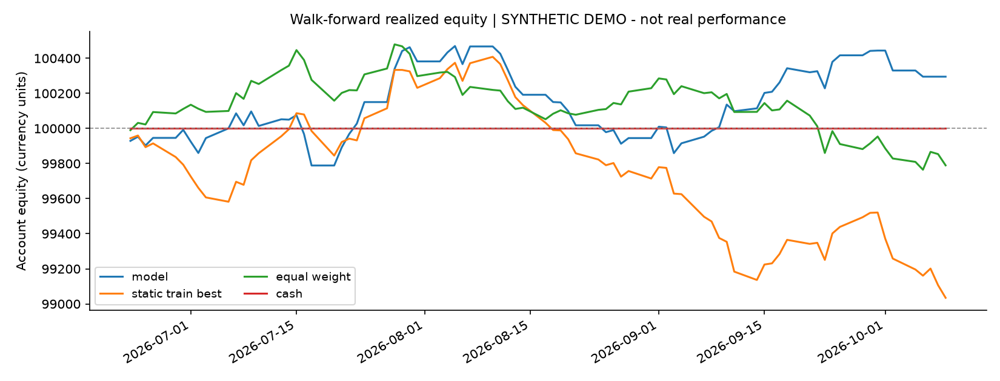
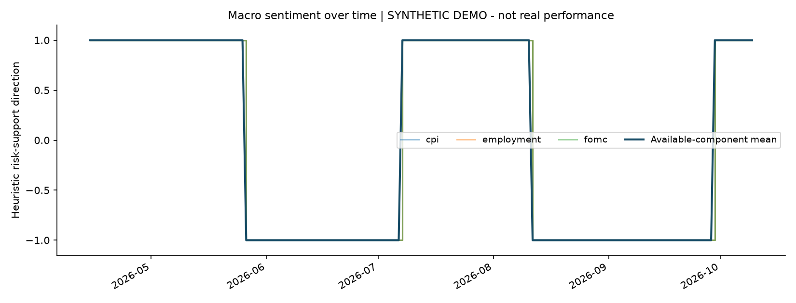
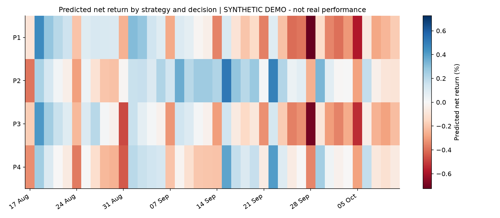
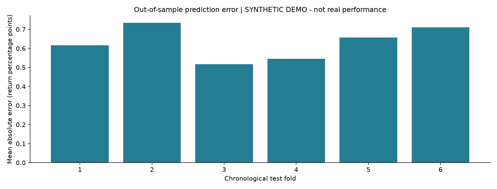

# Evaluation report

**Status: SYNTHETIC DEMO - not real performance.**

The supplied assignment contained no historical trading logs or API credentials. The included default run is synthetic. Live Apify/Tavily retrieval and real-trade validation remain unexecuted until access and logs are supplied.

## Data and validation

129 opportunities, 4 permutations, 6 outer test folds; 79 unique out-of-sample decisions. An expanding window starts after 50 opportunities, then tests the next 15. Training trades must exit before a 24-hour pre-test embargo. Inner validation uses the last 20% of available training opportunities, with exit-time purging. Ridge and a shallow random forest are selected by inner MAE; the outer test is never used for model selection.

All strategy permutations for a decision remain together. During a test window the model stays fixed, but lag features may update using only earlier closed trades. This simulates sequential online observation. Test results are concatenated once, with no duplicate opportunity selections. A fresh full-history fit produces the next decision forecast separately; it is not evaluated as out-of-sample.

## Measured performance

| Policy | Total return | Sharpe | Sortino | Max drawdown | Positive-P&L days |
|---|---:|---:|---:|---:|---:|
| model | 0.30% | 0.865 | 1.267 | -0.61% | 46.84% |
| static_train_best | -0.97% | -2.530 | -3.303 | -1.37% | 40.51% |
| equal_weight | -0.21% | -0.709 | -0.967 | -0.71% | 48.10% |
| cash | 0.00% | undefined | undefined | 0.00% | 0.00% |

Executed model trades: 65; selected-but-abstained decisions: 14. Executed-trade win rate: 56.92%.

Available macro feature proportions: {"cpi": 1.0, "employment": 1.0, "fomc": 1.0}. Missing news/macro data are imputed only within training pipelines, with missing indicators; they are not proof of a neutral economy.

### Metric definitions

Net P&L = gross P&L minus supplied fees (fees must include commission, spread and slippage). Initial account capital = 100,000. Daily realized P&L is grouped by UTC exit date and divided by previous account equity. Weekdays without trades are included between the first and last test date. Annualization assumes 252 sessions and a zero risk-free rate. Sharpe = sqrt(252) times mean daily excess return / sample standard deviation. Sortino uses sqrt(mean(min(excess_return, 0)^2)) over all days, including zeros. A zero denominator produces an undefined metric, not infinity. Drawdown includes initial equity and is the minimum equity / running peak - 1. This is realized-close accounting, so intra-trade losses and mark-to-market drawdown are not captured. Weekdays approximate sessions; exchange holidays are not separately identified. Daily win rate and executed-trade win rate answer different questions.

### Comparators

Static training-best selects the permutation with highest mean historical net return before each outer test. Equal weight divides the same capital across all permutations and averages their net P&L, assuming scalable fractional fills. Cash earns zero. The model chooses the highest predicted net return and abstains when that prediction is nonpositive; no threshold is optimized on the test data.

## Limitations and interpretation

Synthetic results only test software behavior; they establish no tradable edge. Real logs must contain comparable counterfactual results for every permutation and opportunity. Logs of only executed strategies have selection bias and cannot reveal unobserved alternatives. All opportunities are nonoverlapping with equal capital per permutation. A production portfolio needs exposure constraints, time-varying costs, mark-to-market data, market calendars, drift monitoring and risk limits. Reported Sharpe/Sortino over short windows are uncertain and assume more independent/stationary returns than may be justified. The 180-day sample may contain very few FOMC/CPI releases; broader point-in-time histories and independent final holdouts are required. No performance or profitability guarantee is made.

Macro direction mapping (lower CPI/rate surprises, higher employment surprises -> more risk support) is an inspectable heuristic, not universal economic sentiment. Different assets/regimes can react differently; surprise signs discard magnitude. The news lexicon ignores context/negation and is not a calibrated sentiment estimator. Historical snapshots fetched today are not backdated: actual/forecast news may have been revised, and the adapter uses collection time as earliest verifiable availability. A real historical macro backtest therefore requires archived original vintages. Current news is used for outlook/current decisions, not injected into past rows.

## Generated charts

## Next-decision forecast

Top known permutation: P4; expected net return -0.254%. Action: abstain. This is one specified future decision timestamp, not a promise of optimal parameters across an entire future interval. See next_period_predictions.csv for every candidate, parameter values, model and forecast timestamp.
